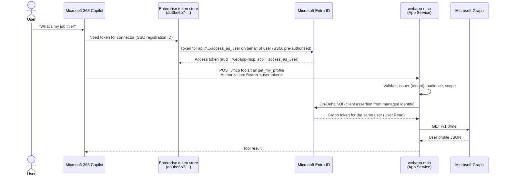

# Setup guide: webapp-mcp as a Microsoft 365 Copilot federated connector

This guide deploys the `webapp-mcp` MCP server to Azure App Service, secures it with Microsoft Entra ID
single sign-on (SSO), registers it in the Teams Developer Portal, and adds it as a custom federated
connector in the Microsoft 365 admin center. It also covers local testing with GitHub Copilot.

- [How it works](#how-it-works)
- [Prerequisites](#prerequisites)
- [Step 1: Create the Entra app registration](#step-1-create-the-entra-app-registration)
- [Step 2: Deploy to Azure App Service](#step-2-deploy-to-azure-app-service)
- [Step 3: Register the SSO client in the Teams Developer Portal](#step-3-register-the-sso-client-in-the-teams-developer-portal)
- [Step 4: Add the generated Application ID URI](#step-4-add-the-generated-application-id-uri)
- [Step 5: Create the connector in the Microsoft 365 admin center](#step-5-create-the-connector-in-the-microsoft-365-admin-center)
- [Step 6: Test in Microsoft 365 Copilot](#step-6-test-in-microsoft-365-copilot)
- [Local testing with GitHub Copilot](#local-testing-with-github-copilot)
- [Configuration reference](#configuration-reference)
- [Troubleshooting](#troubleshooting)
- [Security notes](#security-notes)
- [Clean up](#clean-up)

## How it works



Key points:

- **Delegated user context** – every request carries a user access token. The server never uses
  application permissions; Microsoft Graph is called **on behalf of the signed-in user** (OBO flow),
  so `get_my_profile` returns exactly what `GET https://graph.microsoft.com/v1.0/me` returns for that user.
- **No secrets in Azure** – the App Service's user-assigned managed identity is a
  [federated identity credential](https://learn.microsoft.com/entra/workload-id/workload-identity-federation-config-app-trust-managed-identity)
  of the Entra app, and Microsoft.Identity.Web uses it as the client assertion for OBO.
- **MCP authorization spec** – unauthenticated requests get `401` with
  `WWW-Authenticate: Bearer resource_metadata=".../.well-known/oauth-protected-resource/mcp"`, and the
  Protected Resource Metadata points to your Entra tenant. VS Code uses this to sign you in automatically.

### MCP tools

| Tool | Description |
| --- | --- |
| `get_my_profile` | Signed-in user's profile from Microsoft Graph `/me` (optional `additionalProperties`, e.g. `department,companyName`). |
| `get_my_token_claims` | Claims of the validated access token (user, tenant, scopes, and calling client app). Useful for troubleshooting. |

Both tools are read-only, as required for federated connectors.

## Prerequisites

| Requirement | Notes |
| --- | --- |
| PowerShell 7+ | `pwsh` |
| .NET 10 SDK | `dotnet --list-sdks` |
| Azure CLI | Signed in with `az login` to the tenant and subscription you want to use (`az account show`). |
| Entra roles | Application Administrator (or Cloud Application Administrator) to create the app registration. Granting tenant-wide admin consent for Graph `User.Read` requires Privileged Role Administrator or Global Administrator. |
| Azure RBAC | Contributor (or Owner) on the subscription / resource group. |
| Microsoft 365 roles | Global Administrator or AI Administrator to create connectors in the Microsoft 365 admin center. |
| Teams Developer Portal | Access to <https://dev.teams.microsoft.com>. |

## Step 1: Create the Entra app registration

```powershell
./deploy/setup-entra.ps1 -CreateLocalDevSecret
```

The script is idempotent and configures the app registration `webapp-mcp` as required by
[Configure Microsoft Entra SSO authentication](https://learn.microsoft.com/microsoft-365/copilot/extensibility/plugin-authentication-entra-sso)
and [SSO for API-based message extensions](https://learn.microsoft.com/microsoftteams/platform/messaging-extensions/api-based-microsoft-entra):

| Setting | Value |
| --- | --- |
| Supported account types | Single tenant (`AzureADMyOrg`) |
| Application ID URI | `api://<clientId>` (+ the Developer Portal URI added in step 4) |
| Access token version | `requestedAccessTokenVersion = 2` |
| Exposed scope | `access_as_user` |
| Web redirect URI | `https://teams.microsoft.com/api/platform/v1.0/oAuthConsentRedirect` |
| Pre-authorized clients | `ab3be6b7-f5df-413d-ac2d-abf1e3fd9c0b` Microsoft Enterprise token store<br/>`1fec8e78-bce4-4aaf-ab1b-5451cc387264` Teams desktop/mobile<br/>`5e3ce6c0-2b1f-4285-8d4b-75ee78787346` Teams web<br/>`aebc6443-996d-45c2-90f0-388ff96faa56` VS Code *(local testing)*<br/>`04b07795-8ddb-461a-bbee-02f9e1bf7b46` Azure CLI *(local testing)* |
| API permissions | Microsoft Graph delegated `User.Read` + tenant-wide admin consent |
| Service principal | Created (enterprise application) |

It also writes `deploy/entra-app.settings.json` (git-ignored) and stores the local development settings in
.NET user secrets (see [Configure local settings with user secrets](#configure-local-settings-with-user-secrets)).

Parameters:

| Parameter | Description |
| --- | --- |
| `-AppName` | App registration display name (default `webapp-mcp`). |
| `-AdditionalIdentifierUris` | Application ID URI(s) from the Teams Developer Portal (step 4). |
| `-CreateLocalDevSecret` | Creates a 90-day client secret and stores it **only** in user-secrets so OBO works on your machine. |
| `-SkipDeveloperClients` | Do not pre-authorize VS Code and Azure CLI (recommended for production). |
| `-SkipAdminConsent` | Skip the Graph `User.Read` admin consent grant. |

## Step 2: Deploy to Azure App Service

```powershell
./deploy/deploy-appservice.ps1
# or
./deploy/deploy-appservice.ps1 -ResourceGroupName rg-webapp-mcp -Location westeurope -Sku P0v3
```

The script uses the subscription that is currently selected in Azure CLI and creates (idempotently):

- Resource group `rg-webapp-mcp`
- User-assigned managed identity `id-webapp-mcp`
- Linux App Service plan `asp-webapp-mcp` (`B1` by default) and web app `webapp-mcp-<hash>` running `DOTNETCORE:10.0`
  (HTTPS only, TLS 1.2, FTPS disabled, Always On)
- App settings for Microsoft.Identity.Web (see [Configuration reference](#configuration-reference))
- Federated identity credential `webapp-mcp-managed-identity` on the Entra app, trusting the managed identity
- `dotnet publish` + zip deploy, followed by a smoke test (`GET /` = 200, anonymous `POST /mcp` = 401)

At the end it prints the values you need in the next step, and stores them in `deploy/appservice.settings.json`:

```text
Teams Developer Portal > Tools > Microsoft Entra SSO client ID registration:
  Base URL  : https://webapp-mcp-1234abcd.azurewebsites.net/mcp
  Client ID : 00000000-0000-0000-0000-000000000000
  Scope     : api://00000000-0000-0000-0000-000000000000/access_as_user
```

## Step 3: Register the SSO client in the Teams Developer Portal

1. Open the [Teams Developer Portal – Microsoft Entra SSO client ID registration](https://dev.teams.microsoft.com/tools/entra-configuration)
   (**Tools** > **Microsoft Entra SSO client ID registration**).
2. Select **Register client ID** (or **New client registration** if you already have registrations).
3. Fill in the form:

   | Field | Value |
   | --- | --- |
   | **Registration name** | `webapp-mcp` |
   | **Base URL** | MCP endpoint printed by the deployment, e.g. `https://webapp-mcp-1234abcd.azurewebsites.net/mcp` |
   | **Restrict usage by org** | Your organization only |
   | **Restrict usage by app** | **Any Teams app** (you can bind it to a published app ID later) |
   | **Client ID** | `clientId` from `deploy/entra-app.settings.json` |
   | **Scope** | `api://<clientId>/access_as_user` (`scope` in `deploy/entra-app.settings.json`) |

4. Select **Save**.
5. Copy both generated values:
   - **Microsoft Entra SSO registration ID** – used by the connector in step 5.
   - **Application ID URI** – added to the Entra app and server in step 4.

## Step 4: Add the generated Application ID URI

The Enterprise token store requests tokens using the Application ID URI generated by the Developer Portal.
That URI must be an identifier URI of the Entra app, and the server must accept it as a token audience.

```powershell
./deploy/setup-entra.ps1 -AdditionalIdentifierUris "<Application ID URI from the Developer Portal>"
./deploy/deploy-appservice.ps1 -SkipBuild
```

- `setup-entra.ps1` adds the URI to `identifierUris` (existing URIs and scopes are kept).
- `deploy-appservice.ps1 -SkipBuild` updates the `AzureAd__Audiences__N` app settings (and redeploys the existing package).

> Note: You can't see multiple identifier URIs in the Entra admin center UI (it only shows the first one), but
> they're visible in the app **Manifest**.

## Step 5: Create the connector in the Microsoft 365 admin center

Follow [Set up custom federated connectors](https://learn.microsoft.com/microsoft-365/copilot/connectors/set-up-custom-federated-connectors):

1. Open the [Microsoft 365 admin center – Add connector](https://admin.cloud.microsoft/#/copilot/connectors/add)
   (**Copilot** > **Connectors** > **Gallery** > **Created by your org** > **Create a new connector** > **Add**).
2. Under **Connect to MCP server**, select **Add**.
3. Enter:

   | Field | Value |
   | --- | --- |
   | **Display name** | e.g. `My profile (webapp-mcp)` |
   | **Base URL** | The same MCP endpoint you used in the Developer Portal, e.g. `https://webapp-mcp-1234abcd.azurewebsites.net/mcp` |
   | **Authentication** | **Microsoft Entra SSO** |
   | **Registration ID** | The **Microsoft Entra SSO registration ID** from step 3 |

   If asked, also provide developer name, website, privacy policy and terms of use URLs.
4. Select **Save**.
5. Roll out: select the connector > **Staged rollout** > choose test **Users** or **Groups**. When ready, select
   **Deploy to all users**.

Changes can take up to 15 minutes to take effect.

## Step 6: Test in Microsoft 365 Copilot

As a user included in the rollout, open Microsoft 365 Copilot, enable the connector and try:

- "Who am I?"
- "What is my job title and office location?"
- "Show my department and company name."
- "Which client application called the webapp-mcp server?" (uses `get_my_token_claims`; expect
  *Microsoft Enterprise token store*)

Server logs: `az webapp log tail -g rg-webapp-mcp -n <app name>` (enable App Service logs first with
`az webapp log config -g rg-webapp-mcp -n <app name> --docker-container-logging filesystem`).

## Local testing with GitHub Copilot

### Configure local settings with user secrets

The source-controlled [`appsettings.json`](../src/webapp-mcp/appsettings.json) only contains empty placeholders.
Your tenant ID, client ID, extra audiences and the local client secret are stored in
[.NET user secrets](https://learn.microsoft.com/aspnet/core/security/app-secrets), outside the repository:

- Windows: `%APPDATA%\Microsoft\UserSecrets\<UserSecretsId>\secrets.json`
- Linux/macOS: `~/.microsoft/usersecrets/<UserSecretsId>/secrets.json`

`<UserSecretsId>` is defined in [`webapp-mcp.csproj`](../src/webapp-mcp/webapp-mcp.csproj). ASP.NET Core loads
user secrets automatically when `ASPNETCORE_ENVIRONMENT=Development`, which both launch profiles set.

`setup-entra.ps1` populates them for you. To set or update them separately, use
[`set-user-secrets.ps1`](../deploy/set-user-secrets.ps1):

```powershell
# Values from deploy/entra-app.settings.json (written by setup-entra.ps1)
./deploy/set-user-secrets.ps1

# Also create a new 90-day client secret on the app registration (needed for get_my_profile locally)
./deploy/set-user-secrets.ps1 -CreateClientSecret

# Existing app registration: pass the IDs and type the client secret at a hidden prompt
./deploy/set-user-secrets.ps1 -TenantId <tenant-id> -ClientId <client-id> -PromptClientSecret

# Add the Teams Developer Portal Application ID URI as an accepted audience (replaces stored audiences)
./deploy/set-user-secrets.ps1 -Audiences "api://auth-..."

# Show the current values (client secret masked)
./deploy/set-user-secrets.ps1 -Show
```

The script pipes the values to `dotnet user-secrets set` through standard input, so the client secret doesn't
appear on a command line, and it keeps any other user secrets you've added. The equivalent manual commands are:

```powershell
dotnet user-secrets set "AzureAd:TenantId" "<tenant-id>" --project src/webapp-mcp
dotnet user-secrets set "AzureAd:ClientId" "<client-id>" --project src/webapp-mcp
dotnet user-secrets set "AzureAd:Audiences:0" "api://auth-..." --project src/webapp-mcp
dotnet user-secrets set "AzureAd:ClientCredentials:0:SourceType" "ClientSecret" --project src/webapp-mcp
dotnet user-secrets set "AzureAd:ClientCredentials:0:ClientSecret" "<secret>" --project src/webapp-mcp
dotnet user-secrets list --project src/webapp-mcp
```

> User secrets are for local development only. In Azure, the same settings are App Service app settings
> (`AzureAd__TenantId`, ...) and the client credential is the managed identity, so no secret is stored anywhere.

### Run the server

```powershell
dotnet run --project src/webapp-mcp
# Listening on http://localhost:5080, MCP endpoint http://localhost:5080/mcp
```

### GitHub Copilot CLI (`.mcp.json`)

[`.mcp.json`](../.mcp.json) points to `http://localhost:5080/mcp` and sends
`Authorization: Bearer ${WEBAPP_MCP_TOKEN}`. Entra ID doesn't support dynamic client registration, so the token
is acquired with Azure CLI (pre-authorized by `setup-entra.ps1`):

```powershell
. ./deploy/get-token.ps1   # dot-source: sets $env:WEBAPP_MCP_TOKEN (valid ~1 hour)
copilot
```

In Copilot CLI, check `/mcp show webapp-mcp`, then ask for example *"Use webapp-mcp to show my profile"*.
To test the Azure deployment instead, change `url` in `.mcp.json` to the `mcpUrl` in `deploy/appservice.settings.json`.

### VS Code (`.vscode/mcp.json`)

[`.vscode/mcp.json`](../.vscode/mcp.json) defines `webapp-mcp-local` and `webapp-mcp-azure` (asks for the App Service
host name). Start a server from the file or the **MCP: List Servers** command. VS Code reads the Protected Resource
Metadata, recognizes Microsoft Entra ID and signs you in with your Microsoft account (VS Code is pre-authorized, so
there is no consent prompt). Then use the tools in Copilot Chat agent mode.

### Quick manual check

```powershell
. ./deploy/get-token.ps1
$headers = @{ Authorization = "Bearer $env:WEBAPP_MCP_TOKEN"; Accept = "application/json, text/event-stream" }
$body = '{"jsonrpc":"2.0","id":1,"method":"tools/call","params":{"name":"get_my_profile","arguments":{}}}'
Invoke-RestMethod http://localhost:5080/mcp -Method Post -Headers $headers -ContentType application/json -Body $body
```

## Configuration reference

| Setting (`appsettings.json` / App Service app setting) | Description |
| --- | --- |
| `AzureAd:Instance` / `AzureAd__Instance` | `https://login.microsoftonline.com/` |
| `AzureAd:TenantId` / `AzureAd__TenantId` | Entra tenant ID. Tokens from other tenants are rejected. |
| `AzureAd:ClientId` / `AzureAd__ClientId` | Client ID of the `webapp-mcp` app registration. |
| `AzureAd:Audiences:N` / `AzureAd__Audiences__N` | Extra accepted audiences (Developer Portal Application ID URI). `ClientId` and `api://ClientId` are always accepted. |
| `AzureAd:ClientCredentials:0:SourceType` | `SignedAssertionFromManagedIdentity` in Azure, `ClientSecret` locally. Used for the OBO flow. |
| `AzureAd:ClientCredentials:0:ManagedIdentityClientId` | Client ID of the user-assigned managed identity (Azure). |
| `AzureAd:ClientCredentials:0:ClientSecret` | Local development only (user-secrets). |
| `Mcp:Scope` / `Mcp__Scope` | Required delegated scope, default `access_as_user`. |
| `ASPNETCORE_FORWARDEDHEADERS_ENABLED` | `true` on App Service so the Protected Resource Metadata advertises `https://` URLs. |

## Troubleshooting

| Symptom | Cause / fix |
| --- | --- |
| `401` with `invalid_token` / audience error in logs | The token audience isn't accepted. Make sure step 4 was done (identifier URI + `AzureAd__Audiences__N`). |
| `403` from `/mcp` | Token doesn't contain the `access_as_user` scope. Check the Developer Portal **Scope** value. |
| `AADSTS65001` (consent) when running `get-token.ps1` | Azure CLI isn't pre-authorized. Re-run `setup-entra.ps1` without `-SkipDeveloperClients`. |
| `get_my_profile` fails locally with a credential error | No client credential configured. Run `./deploy/set-user-secrets.ps1 -CreateClientSecret` (check with `-Show`). |
| App fails to start: `AzureAd:TenantId and AzureAd:ClientId must be configured` | User secrets aren't set, or `ASPNETCORE_ENVIRONMENT` isn't `Development`. Run `./deploy/set-user-secrets.ps1`. |
| `get_my_profile`: consent or additional sign-in required | Graph `User.Read` admin consent is missing. Grant it in Entra admin center > App registrations > `webapp-mcp` > **API permissions** > **Grant admin consent**. |
| `AADSTS70021` / `AADSTS700213` in App Service logs | Federated identity credential doesn't match the managed identity. Re-run `deploy-appservice.ps1`. |
| Connector doesn't show up / old behavior | Connector changes can take up to 15 minutes. Check the staged rollout includes your user. |
| Not sure who's calling | Ask Copilot to run `get_my_token_claims`; `clientApp` shows the calling client (token store, VS Code, Azure CLI). |

## Security notes

- The VS Code and Azure CLI pre-authorizations exist only to make local testing frictionless. For production,
  run `./deploy/setup-entra.ps1 -SkipDeveloperClients` and remove those entries from **Expose an API** >
  **Authorized client applications**.
- The local client secret is stored only in dotnet user-secrets and expires after 90 days. Remove it with
  `az ad app credential list --id <clientId>` / `az ad app credential delete --id <clientId> --key-id <keyId>`.
- The Azure deployment is secretless (managed identity + federated identity credential).
- `deploy/*.settings.json` files are git-ignored; they contain IDs only, no secrets.

## Clean up

```powershell
az group delete --name rg-webapp-mcp --yes
az ad app delete --id <clientId>
dotnet user-secrets clear --project src/webapp-mcp
```

Also delete the connector in the Microsoft 365 admin center and the SSO registration in the Teams Developer Portal.
